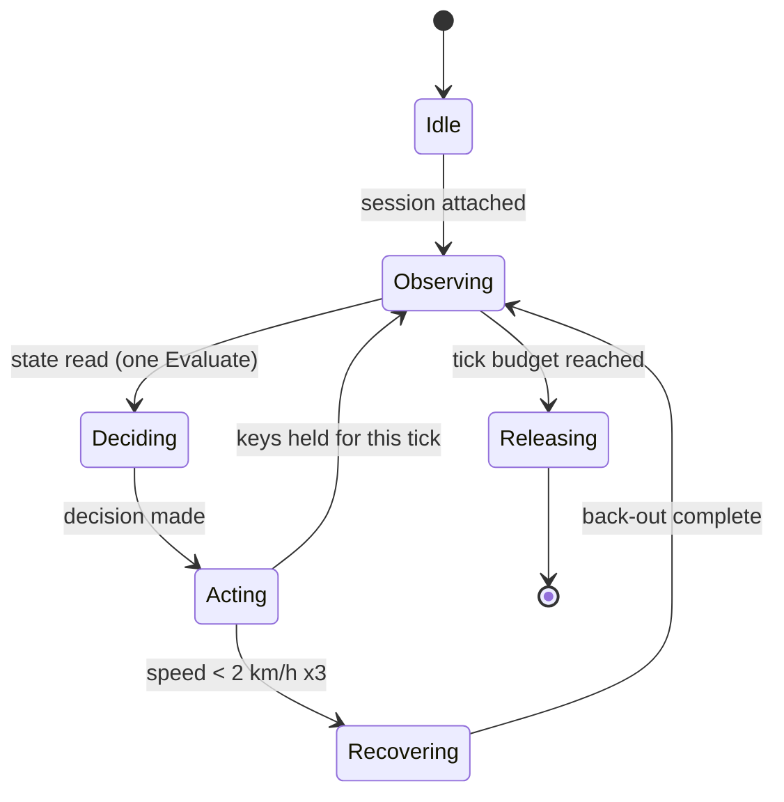
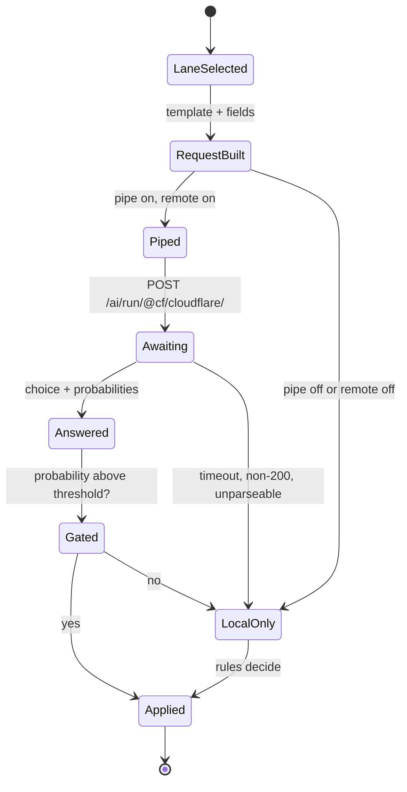

# State charts

What the driver sends, what comes back, and how it reaches the game. Three
diagrams, in the order the data travels.

---

## 1. The tick



`Observing` is a single `Evaluate` that returns the car. `Deciding` is either
the rule engine alone (`power = user`), the rule engine plus a model's opinion
(`agito`), or the model's answer alone (`model`). `Acting` holds keys through
an in-page 16 ms interval, so a tick costs one round trip rather than one per
key.

---

## 2. Send and receive



The important edge is `Awaiting --> LocalOnly`: **every** failure falls back to
the rules, because a model that is slow, rate-limited or wrong must not stop a
car doing 40 km/h. `Gated` is the other half: an answer is obeyed only above a
threshold, and recorded otherwise.

---

## 3. Where it enters the game

```mermaid
stateDiagram-v2
    [*] --> Rust
    Rust --> Agito: Browse::Evaluate
    Agito --> Page: CDP evaluate
    Page --> Game: session.input.key(code, true) every 16 ms
    Game --> Memory: car state at car+0x60 / +0x40c / +0x430
    Memory --> Rust: returned as the value of the same Evaluate
```

Nothing is injected through the DOM: the page's own input API writes the game's
input ring, so a held key is a page-side interval and not a stream of CDP
events. That is why Agito needed no input verb, and why the whole loop is two
`Evaluate` calls per tick - one to read, one to act.

---

## 4. The states we send

Each lane is a state, not a request: the fields a question reads, and nothing
else.

| lane      | fields                                            | when                   |
| --------- | ------------------------------------------------- | ---------------------- |
| `drive`   | speed_kmh, gear, route_cue_x                      | every tick             |
| `corner`  | speed_kmh, heading_degrees, route_cue_x, yaw_rate | approaching a turn     |
| `recover` | speed_kmh, gear, grounded, surface                | stuck or slipping      |
| `race`    | speed_kmh, gear, racetype, track, route_cue_x     | racetype 1 or 7        |
| `context` | the full sixteen                                  | judgement, not control |

Measured on `clef-flash` with the same question: 375 input tokens for `drive`,
499 for `context`. The lanes buy tokens and honesty about what each question
reads; speed comes from cadence, not from a smaller body.

---

## 5. What comes back

A `choice` question returns the chosen option and a probability for every
option; a `score` question returns a weighted value and its legend. Nothing is
free text, so nothing has to be parsed - and a parse failure at 40 km/h is not a
failure mode this design has.

Measured on the `freeroam.track_cue` template: the model chose `throttle` for
both a left and a right cue, with probabilities within 0.09 of each other. That
is a coin flip with a margin, which is exactly why the gate exists and why the
rules keep the car.

---

## 6. Where the templates live

`Templates/` is data, not code: `Observation.json` names the fields and their
addresses, `Questions.json` names the lanes and the typed questions. A driver
reads them at runtime, so a template can be changed without rebuilding the crate

- which is the point of keeping them out of the binary.
